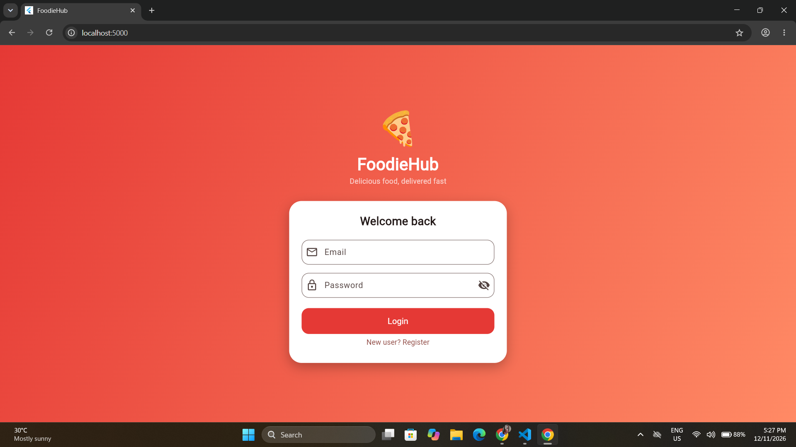
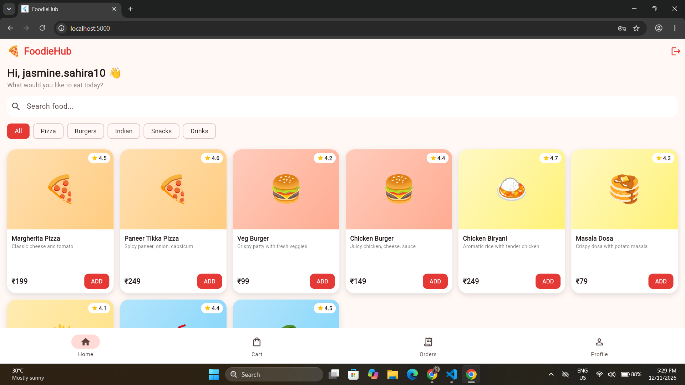
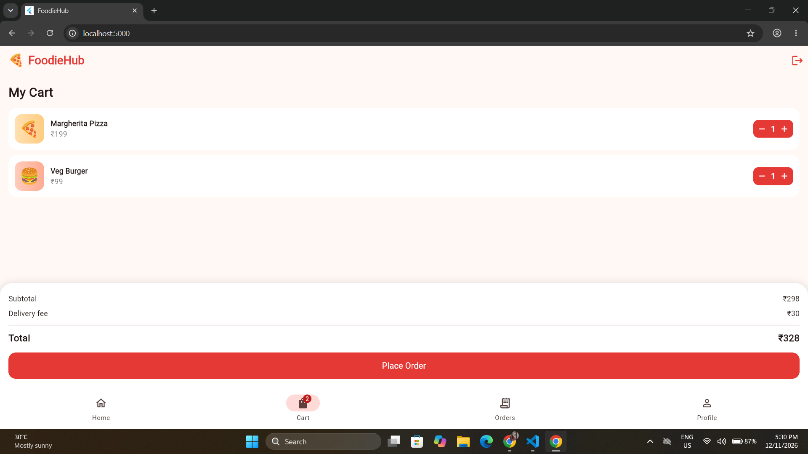
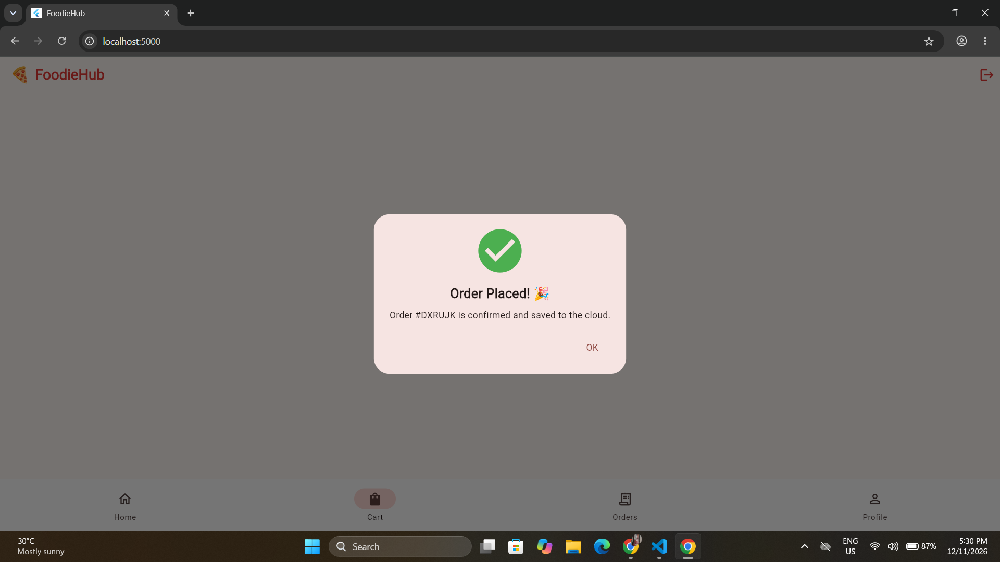
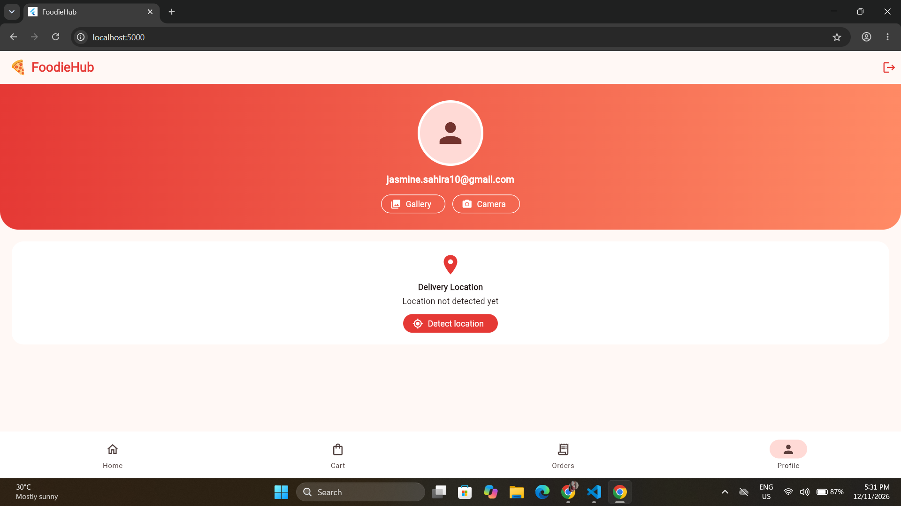

# FoodieHub (Flutter Capstone)
A food ordering app for web and mobile.

Live Website: https://cloud-notes-44136.web.app
Demo Video: https://drive.google.com/file/d/15cC_A0zrt3-7Qjpzoyo7CclOaDlTziy7/view?usp=drive_link
Documentation: docs/ARCHITECTURE.md

## Features
- Register / Login / Logout (Firebase Authentication)
- Orders saved in Cloud Firestore
- Cart saved locally (shared_preferences)
- State management with Provider
- Search and category filters
- Gallery/camera photo and device location
- Order confirmation notification
- Error handling and Firestore security rules
- Deployed with Firebase Hosting

## Screenshots

